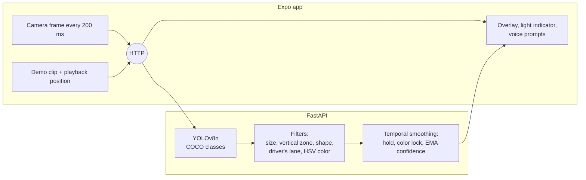

# ClearPath

A driving assistant for colorblind, elderly and low-vision drivers. A phone mounted on the dashboard watches the road, a computer-vision backend finds traffic lights, stop signs and pedestrians, and the app announces them with high-contrast visuals and recorded voice prompts in four languages.

Built at the Calvin University Hackathon in March 2026.

## What it does

| | |
|---|---|
| **Traffic lights** | Detects the light for the driver's lane and reads its color (red, yellow or green). Red is announced after fewer confirming frames than yellow, because missing a red is worse than a late yellow. |
| **Stop signs and pedestrians** | Each class has its own confidence threshold and its own count of consecutive frames before the app speaks, so a single noisy frame never triggers an alert. |
| **Voice prompts** | Recorded male and female voices in English, Spanish, Romanian and Mandarin, with text-to-speech as a fallback. |
| **Accessibility** | Large type in Lexend, dark, light and high-contrast themes, an onboarding flow for elderly and low-vision profiles, and toggles to mute whole categories. |
| **Demo mode** | Plays bundled dash-cam clips and runs detection on the exact frame on screen, so the system can be shown without driving. |



## How detection works

The stock YOLOv8n model knows "traffic light", "stop sign" and "person" but not light colors, so the backend layers classical computer vision on top of it:

1. **Region filters** drop boxes that are too small or too large, too close to the sky or the hood, not tall enough to be a light, or on the opposing-lane side of the frame (configurable for left-hand traffic).
2. **Color from HSV.** Inside each light box, the backend finds the brightest blob, uses its vertical position as the first guess, and confirms it with HSV color masks. A separate night mode compares bloom brightness across the red, yellow and green sections.
3. **Stop-sign guard.** A box that is mostly uniform red is treated as a stop sign, not a red light.
4. **Temporal smoothing.** A confirmed light is held through short misses, a new color must win two frames in a row to replace it, and confidence is an exponential moving average that rises fast and decays slowly.
5. **Non-blocking demo inference.** In demo mode, YOLO runs on a background thread and each request returns the latest finished result, so video playback never waits on the model.

## Running it

### Backend

Requires Python 3.11+.

```bash
cd Backend
python -m venv .venv
.venv/Scripts/activate            # macOS/Linux: source .venv/bin/activate
pip install -r requirements.txt   # CPU-only: add --extra-index-url https://download.pytorch.org/whl/cpu
uvicorn app.main:app --host 0.0.0.0 --port 8000
```

The YOLOv8n weights download automatically on first start. Settings live in `Backend/.env` (see `.env.example`).

Run the tests with `pytest` from `Backend/`.

### App

Requires Node.js 20+ and [Expo Go](https://expo.dev/go) (SDK 57) on your phone.

```bash
cd Frontend
npm install
cp .env.example .env              # set EXPO_PUBLIC_BACKEND_URL to your computer's LAN IP
npx expo start
```

Scan the QR code with Expo Go. Then open the camera screen and tap **DEMO** to run the bundled clips, or point the phone at the road.

## Project layout

```
Backend/
  app/api/routes/       detection, demo and health endpoints
  app/vision/           detector, region/color filters, temporal smoothing, video streamer
  tests/                pytest suite for the vision pipeline and API
  test_video.py         run the full pipeline on a clip with annotated output
  ClearPath_videos/     dash-cam clips used by demo mode
Frontend/
  screens/              onboarding, home and camera screens
  components/           overlay, light indicator, banner, settings, demo video
  utils/                audio, speech, translations, theming, profile storage
  assets/audio/         recorded voice prompts (en, es, ro, zh)
```

## Limitations and next steps

- The color of distant lights is often unresolved, so they show as a generic "traffic light". Fine-tuning a detector that knows light states, for example on the Bosch Small Traffic Lights dataset, would remove the HSV step for most cases.
- Inference runs on a laptop on the same network. Exporting the model to Core ML or TFLite would allow on-device detection.
- The demo clips make the repository large. They could move to release assets.

## Team

Designed and built by **Eduard Dehelean** (project lead): system architecture, the computer-vision backend and detection pipeline, demo mode, and integration with the app.

Team: Pauline Lu, Anna St. Clair, Gregory Goodfellow.
